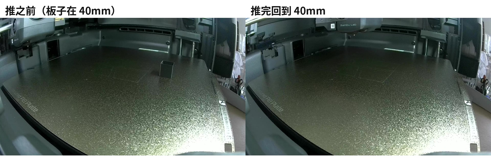
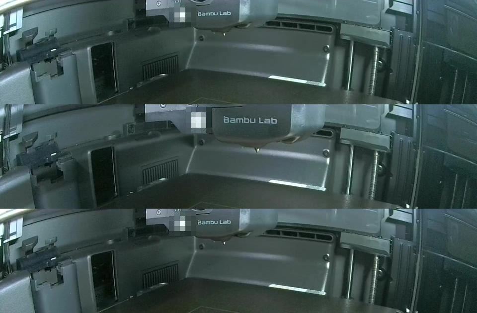

# X2D 冷推件 · x2d-cold-push

**拓竹 Bambu Lab X2D 打完 PETG 件，等热床凉下来，用喷头把件推下打印板。不加任何配件。**

> ⚠️ 实验性。我们一台 X2D 上：**单个小方块成功 1 次（2026-10-11）**；把整块钢板推走 2 次（10-07、10-11）；
> 一盘 8 件的支架**推了三轮一件没推下**（10-16，教训见下）。10-16 加的分段推 + 降电流**只在空板上测过**。
> 你的机器、料、件不一定一样。推之前先用 `plan_push.py` 看这盘能不能推。



## 必要条件（缺一条都可能推不下来，或者把钢板推走）

| # | 条件 | 为什么 |
|---|---|---|
| 1 | **首层热床 70℃**（拓竹 PETG Basic 官方默认），**不要 80℃** | 10-07 用首层 80℃，件没下来、钢板被推走；10-11 用 70℃ 推下来了 |
| 2 | **不加外边（brim）** | 外边让贴板面积变大，粘得更牢 |
| 3 | **热床凉到 35℃ 以下再推**，放得越久越好推 | 拓竹纹理 PEI 板官方原文："wait until it reaches 35℃ or lower"。实测关门从 70℃ 凉到 35℃ 约 37 分钟。放一夜 / 一整天的件「轻轻一拉就掉」（10-12、10-16） |
| 4 | **摆成一排靠门、每件一条车道、别在中间**（`plan_push.py` 判「一轮能推完」） | 10-16：件铺满整板、一件后面还有一件 → 喷头没地方下、一推顶一串、件边走边转 |
| 5 | **出口放接件盒** | 件会被直接弹出板子前沿，没接住会掉地上 |
| 6 | **局域网模式 + 开发者模式** | 推件动作是空闲时通过局域网 MQTT 的 `gcode_line` 发的 |

## 怎么用

```bash
pip install "paho-mqtt>=2"
export X2D_HOST=192.168.x.x        # 打印机 IP
export X2D_SERIAL=xxxxxxxx         # 序列号
export X2D_ACCESS_CODE=xxxxxxxx    # 局域网访问码（打印机屏幕上看）

# 1. 开打之前：看这盘能不能推（读切片导出的 .gcode.3mf，不连打印机）
python3 plan_push.py 某盘.gcode.3mf --json plan.json

# 2. 打完：等凉
python3 x2d_cold_push.py wait-cool

# 3. 一条车道一条车道推（先 --dry-run 看要发的 G-code）
python3 x2d_cold_push.py lane --plan plan.json --lane 1 --current 0.3 --dry-run
python3 x2d_cold_push.py lane --plan plan.json --lane 1 --current 0.3

# 只有一个小件时，也可以用 10-11 那套一口气推：
python3 x2d_cold_push.py push --x 128 --part-back-y 67.5
```

### plan_push.py 算什么

读 G-code，按对象算：XY 范围、**按前后每 4mm 一段的高度**（不是整件最高）、喷头从后面接近会不会碰、在哪片空地下喷头、
每件走哪条车道、推它会不会顺带顶上前面的件、车道压不压擦嘴条。最后给「一轮能不能推完」，不能就说为什么。

拿 10-16 那盘支架跑：两根贯穿前后的长件「接近线挡死」；最大的托架一推会连带 4~5 件；车道压擦嘴条 → 不能。
这正是我们实际推了三轮才碰到的三件事。

用到的数（我们这台机器上的实测或切片参数原文，不是头壳图纸）：喷头在 Y245、Z3 横移，没碰到前方 27mm 处 20.2mm 高、
41mm 处 42.2mm 高的零件；车道半宽 35mm（推 22mm 间距的挂钩一次顶 2~3 个，推断）。更高的件没数据，一律判「不知道」。

### lane 做什么

1. XY 归零；在下喷头空地碰板归 Z
2. 抬到 Z60 移到下喷头空地，降到 Z3（空地上方没有件）
3. 可选：`M17 S` 存电流、`M17 X.. Y..` 降 XY 电流
4. 贴板横移到车道（在所有零件后面走）
5. 往门口分段推：默认 10、10、20、30、30… mm，每段等打印机回 SUCCESS 再发下一段；第一段前停下等你按回车
6. 收尾（中途出错、Ctrl+C 也会做）：`M17 R` 恢复电流 → 抬高 → **重新归零**（低电流可能丢步，坐标不可信）→ 停车

空板实测一条车道全程约 4 分钟，其中推的那段 86 秒（同样距离一步一步手动发要 8 分多钟）。

### 降电流（力度上限）

推件卡住时，满电流的电机会硬顶，伤板、伤喷头。拓竹官方结束 G-code 对 Z 轴就是这么防撞的：
`M17 S` → `M17 Z0.4 ; lower z motor current to reduce impact if there is something in the bottom` → `M17 R`。
我们把同样的办法用在 XY 上，`x2d_cold_push.py current-test` 在空板上验证：

| 电流 | 喷头加速度 10000、F18000 来回 4 趟后回同一点 | 说明 |
|---|---|---|
| 0.6 A | 位置不变（模板匹配差 ≤2 像素） | 0.6A 还很有劲，当不了力度上限 |
| 0.3 A | **位置偏了**（喷头明显不在原处） | 丢步 → `M17 X Y` 在 X2D 上确实生效 |
| 0.3A 后 `M17 R` | 同样来回，位置不变 | 恢复有效 |



X2D 开打 G-code 里有 `M17 D ; reset motor current to default`，下一盘开打会重置电流。
**没验证的**：0.3A 推不推得动真件、卡住时会不会及时打滑。0.3~0.6A 之间该取多少不知道。

## 已知问题

- **擦嘴条挡在出口**：X2D 每次开打都会在板子最前沿（y≈0、从 x100 起约 40 mm、0.6 mm 高）画一条出料线（`nozzle load line`，`G130 … L40 E12`），留在板上，正好在出口。`plan_push.py` 会提示压到它的车道。
- **钢板往前没有东西挡**：钢板靠磁吸 + 后定位销，往前推没有限位。件粘得牢时，推的是整块板（10-07、10-11 各一次）。
- **件会转、会散**：10-16 推一个底面 76×44mm 的托架，推的点偏在一侧，它边走边转，顶着的小件散开、脱离车道。
- **最后一截推不出板边**：10-16 托架被推到前沿、悬出去一截后不再跟着走（喷头最远到 Y2）。原因没查清：可能推的点滑开了，也可能搭在热床前沿的框上。
- **没有自动看画面**：程序不会判断「件有没有跟着走」，现在靠降电流兜底（卡住就打滑）。
- **没有「板空了」检测**：别无人值守连打——推件失败时下一盘会直接打在没推走的件上。

## 测试方块（约 1 克）

```bash
python3 make_test_cube.py test_cube_15.stl
```

切片设置：2 圈墙、0% 填充、无顶面、底 3 层、无外边、首层热床 70℃、首层速度 20 mm/s。放在板子前部中间（我们放在 (128, 60)，后沿 y=67.5）。
我们这次：0.92 g、约 20 分钟。

## 实测记录

| 日期 | 件 | 首层热床 | 外边 | 冷却 | 结果 |
|---|---|---|---|---|---|
| 2026-10-07 | 两个 PETG 短钩 | 80℃ | 无 | 约 45 分钟（没测温） | ❌ 件没下来，整块钢板被推得往前、往右走 |
| 2026-10-11 | 15 mm 空心方块（0.92 g） | 70℃ | 无 | 到 35.0℃（打完后约 37 分钟，关门） | ✅ 件被推下板并弹出，钢板没动（推前推后同一高度两帧对比） |
| 2026-10-11 | 一排 10 个挂钩（22mm 间距，带连接片） | 70℃ | 无 | 到 35℃ | ❌ 喷头一次顶 2~3 个，整块钢板被推出热床，板受伤 |
| 2026-10-16 | 一盘 8 件 AMS 翻折支架（219 g，铺满整板） | 70℃ | 无 | 放了 8 小时，床 31℃ | ❌ 两根贯穿前后的长件没法推（手取）；托架顶着 4 件一起走，边走边转，卡在板边，一件没推下（手取）。件本身「轻轻一拉就掉」——挡路的是摆法，不是粘 |
| 2026-10-16 | 空板 | — | — | — | ✅ `current-test` 0.6A / 0.3A；`lane --current 0.3` 一条车道走完，收尾恢复电流、重新归零 |

## 接下来要做

- [ ] 0.3~0.4A 推真件：推得动吗、卡住会打滑吗
- [ ] 自动看画面判断件有没有跟着走、钢板有没有动
- [ ] 最后一截推出板边（板边那截怎么送出去）
- [ ] 连续推件时只在第一盘画擦嘴条
- [ ] 把推件写进打印结束段，打完自动等凉、自动推
- [ ] 前沿限位，防止钢板被推走；出口接件盒

## English summary

Push PETG parts off a Bambu Lab X2D plate with the toolhead, no add-ons. **Experimental.**
Worked once for a single small cube (2026-10-11); pushed the whole steel plate off twice; a full 8-part plate (2026-10-16) could not be cleared in three tries — the layout, not adhesion, was the problem.
- `plan_push.py` reads a sliced `.gcode.3mf` and tells you, before printing, whether the plate can be cleared in one round (per-part height profile along Y, approach clearance, lanes, parts that would be pushed together, nozzle load line).
- `x2d_cold_push.py lane` pushes one lane in growing segments over one MQTT session, optionally with reduced XY motor current (`M17 S` / `M17 X.. Y..` / `M17 R`, the same trick Bambu's end G-code uses on Z) so a jam makes the motor skip instead of forcing. Always restores current, lifts and re-homes at the end.
- Empty-plate test: 0.3 A makes XY skip under hard moves (so the command works), `M17 R` restores it. Not yet tested on real parts.
Conditions: first-layer bed 70 °C (not 80 °C), no brim, bed ≤ 35 °C, one row near the door, a catch box. Use at your own risk.

## 免责声明

开发者模式下手动发运动指令，可能撞头、刮板、把钢板推走。推的时候人在旁边、手边就是电源开关。风险自负。

## License

MIT
